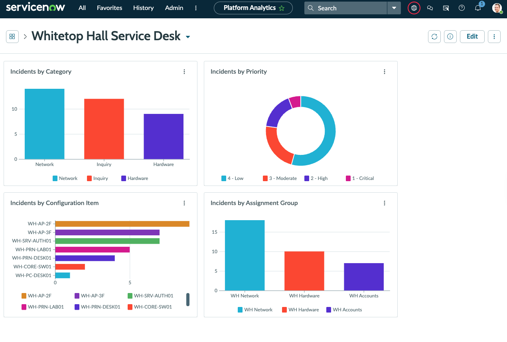
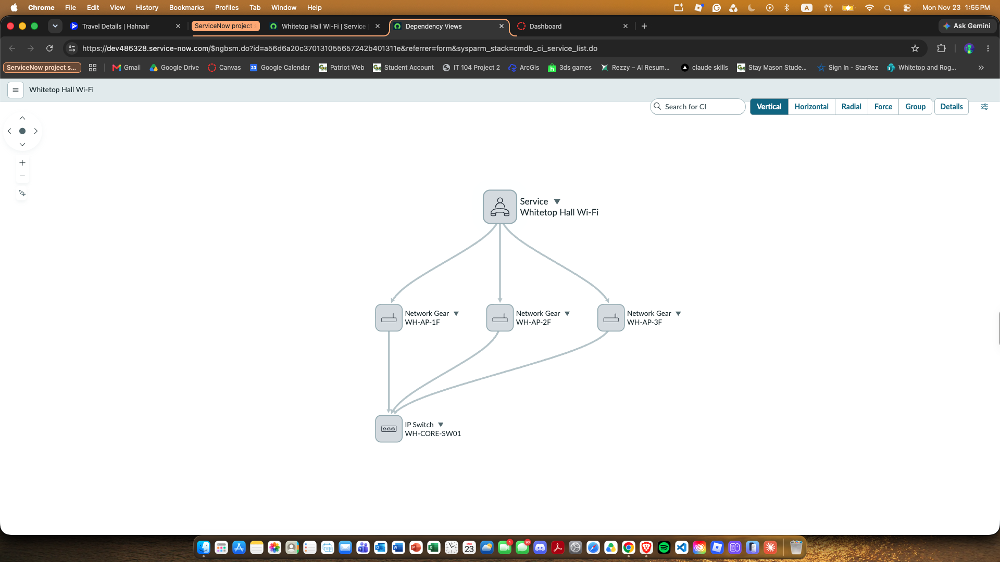
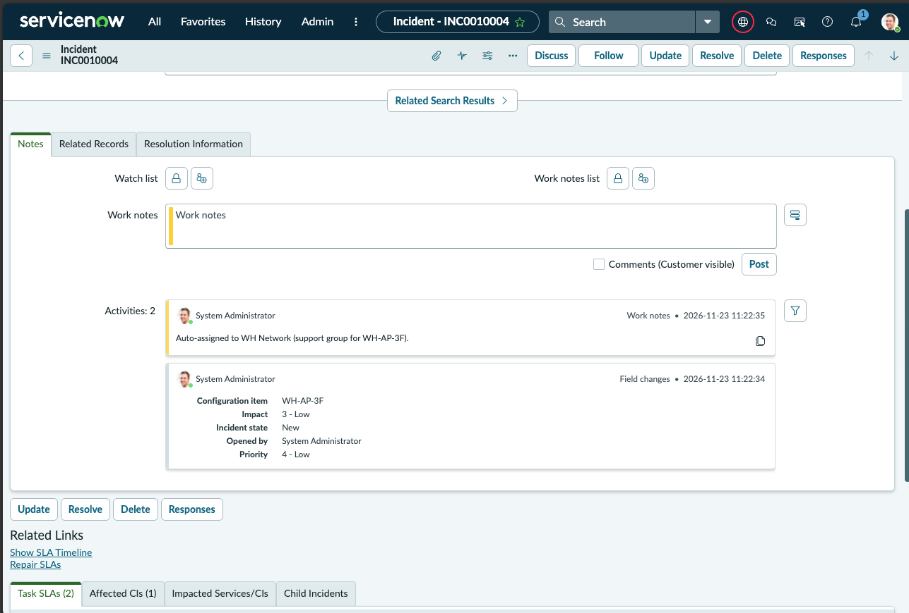
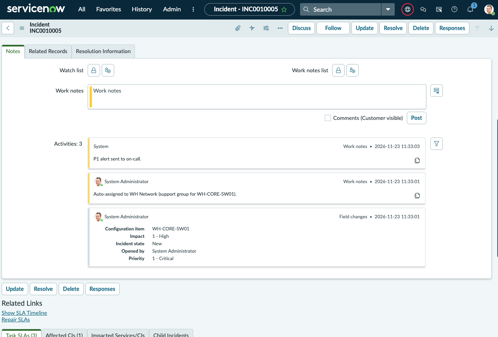

# Whitetop Hall IT Service Desk on ServiceNow

A mock enterprise IT service desk for a university residence hall. I built it in a ServiceNow Personal Developer Instance to practice ITSM: incidents, requests, knowledge, CMDB, automation and reporting.

> All ticket data is generated for demonstration. Whitetop Hall is the residence hall where I work as an RA.



## What I built

| Area | What's in it |
| --- | --- |
| **Service desk** | 3 assignment groups (WH Network, WH Hardware, WH Accounts) and a 4-hour P1 resolution SLA that runs 24/7 |
| **Service Catalog** | 2 request items with 6 variables: *Guest Device Wi-Fi Access* and *Software Install Request* |
| **Knowledge** | 3 articles published through the review/approval workflow |
| **CMDB** | 10 CIs, 7 `Depends on::Used by` relationships, and an ownership data-quality check and fix |
| **Automation** | A JavaScript business rule that auto-assigns from the CI's support group, plus a Flow Designer P1 alert (email + work note) |
| **Integration** | A Python script that creates incidents through the REST Table API, using a least-privilege integration account |
| **Reporting** | A Platform Analytics dashboard with 4 charts, plus a written finding and recommendation |

## How it fits together

```
Resident → Portal (catalog items / knowledge)
              │
Python script ──REST API──► Incident ──► Business rule: CI → support group → assignment + work note
                                │
                                ├──► P1? → Flow: alert email + work note
                                ├──► SLA: P1 resolution clock (4h, 24/7)
                                └──► Dashboard: category / priority / CI / group

CMDB:  Whitetop Hall Wi-Fi ─depends on─► WH-AP-1F/2F/3F ─depends on─► WH-CORE-SW01
```



## Automation

**Business rule: auto-assign from the CI's support group** (Incident · before insert · order 50)

```javascript
(function executeRule(current, previous) {
    if (!current.assignment_group.nil() || current.cmdb_ci.nil()) return;
    var supportGroup = current.cmdb_ci.support_group;
    if (!supportGroup.nil()) {
        current.assignment_group = supportGroup.toString();
        current.work_notes = 'Auto-assigned to ' + supportGroup.getDisplayValue() +
            ' (support group for ' + current.cmdb_ci.getDisplayValue() + ').';
    }
})(current, previous);
```

**Result:** 30 of 30 API-created incidents were routed automatically, each with an audit work note.



**Flow: P1 incident alert.** When an incident is created with Priority 1 - Critical, the flow sends an alert email and adds the work note "P1 alert sent to on-call."



## Running the script

```bash
pip install requests
export SN_INSTANCE=devXXXXXX
export SN_USER=wh.api.integration
export SN_PASS='...'          # never committed
python3 scripts/create_incidents.py      # creates 30 incidents
```

The script looks up each CI's `sys_id`, then POSTs incidents with a weighted mix of realistic scenarios. Sample output is in [`docs/step5-script-output.txt`](docs/step5-script-output.txt).

## Finding

- **WH-AP-2F** generated **9 of 35 incidents (26%)**, more than any other CI.
- Wi-Fi made up **51%** of all ticket volume.

**Recommendation:**
- Survey floors 2–3 and replace or reposition that access point.
- Link the password-reset and Wi-Fi knowledge articles from the portal to cut repeat tickets.

Full write-up: [`docs/findings.md`](docs/findings.md)

## Problems I hit and how I solved them

- **My business rule never fired.** An out-of-box rule (*Populate Assignment Group based on CI/SO*) ran first at the same order. I found it by searching active rules that reference `support_group`, then moved mine to order 50.
- **The API returned 401 with the correct admin password.** The instance enforces basic-auth restrictions (`glide.authenticate.basic_auth.restriction.enforce`). Instead of widening admin's access, I created a machine-identity integration user with only `itil` and `snc_basic_auth_api_access`.
- **A CMDB filter matched the wrong records.** `starts with WH` also matched demo CIs like "WhatsUp Gold". I tightened it to `WH-`. See [`docs/cmdb-cleanup.md`](docs/cmdb-cleanup.md).
- **Knowledge articles were stuck in Review.** The knowledge base routes approvals to its manager, so I approved them as admin through `sysapproval_approver`.

## Repo contents

```
README.md                  this file
PROGRESS.md                step-by-step build log
scripts/create_incidents.py
docs/cmdb-cleanup.md       CMDB data-quality check
docs/findings.md           dashboard finding + recommendation
docs/step5-script-output.txt
screenshots/               evidence for each step
exports/                   update set XML + data exports
```

## What I'd do next
- **Problem management:** link the repeat Wi-Fi incidents on WH-AP-2F to one problem record.
- **Self-service password reset:** add a Virtual Agent topic to deflect account lockout tickets.
- **Change management:** add a normal change with CAB approval for replacing the access point.
